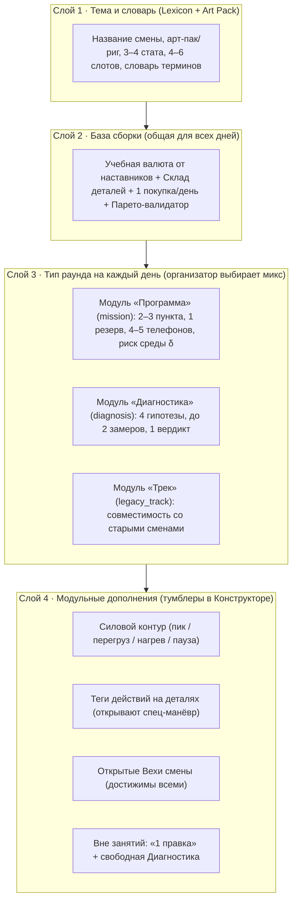

# Спецификация «Ядро 3.0» для дизайн-редизайна и конструктора смен (`stem_bot`)

> **Адресат:** агент дизайна/фронтенда (`apps/web`, `docs/design/ux-v3/`) и команда продукта (Леон, Ренат, Егор, Даня, Вася).
> **Назначение:** единое ТЗ на переработку игрового цикла, экранов игрока, табло проектора и **самостоятельного Конструктора смен для организаторов STEM ЦУ** на базе «Ядра 3.0».
> **Основа документа:** бриф команды STEM ЦУ (Евгений Личкин + все вложенные материалы *НейроФауны*), программа декабрьского Спринта ЦУ (`cu.ru/events/bachelor-sprints`, 1–6 декабря 2026), аудит кода (`packages/shared/src/{schema,engine,rover-preset}.ts`), UX-аудит [RESEARCH_AND_CJM.md](./ux-v3/RESEARCH_AND_CJM.md) и независимая математическая проверка (`gpt-6.2-sol`).

---

## 1. Главный продуктовый сдвиг (что именно мы перерисовываем)

В версиях v1–v2 игра сводилась к «магазину карточек с `+2/−1` + кнопка ведущего „Применить ход“». Даже на идеальном экране UX v3 это остаётся табличкой оптимизации одной цифры: покупки — единственное действие, капитан жмёт кнопки, остальные 3–4 подростка смотрят.

**В «Ядре 3.0» центр тяжести меняется радикально:**
1. **Покупки больше не финал, а подготовка инструментов.** Главный игровой момент наступает **после** рынка — в коротком, нервном, командном испытании раунда, где **каждый из 4–5 участников одновременно на своём телефоне принимает собственное исполняемое решение**.
2. **Две полноценные STEM-механики раунда + модульные надстройки (SDK):** организатор смены сам выбирает, какие дни идут в режиме **«Программа»** (управление маршрутом и ресурсом под риск), какие — в режиме **«Диагностика»** (научный метод: выбор замеров для отсева гипотез), а при желании включает классический **«Трек»**, **Силовой контур**, **Теги действий** и **Открытые Вехи**.
3. **Самостоятельная сборка смены организатором:** преподаватель/методист без разработчика собирает новую тему за 10 минут — переименовывает словарь темы, настраивает расписание дней, проверяет **Парето-баланс** в 1 клик и ведёт живой 20-минутный урок с 1 экрана.
4. **Игра жива вне занятий (3 минуты в чате, 0 фарма валюты):** свободные режимы *«Спаси заезд одной правкой»* и *«Диагностика сбоя»* с пересылкой карточки-вызова в Telegram, которые развивают инженерное мышление и **не ломают** учебную экономику смены.

> [!IMPORTANT]
> **Согласование с UX v3 ([RESEARCH_AND_CJM.md](./ux-v3/RESEARCH_AND_CJM.md)):**
> Мы полностью сохраняем 4 принципа UX v3:
> 1. **Phase-Driven UI** — ровно одно главное действие на текущую фазу, 0 лишних вкладок.
> 2. **Mechanics First, Lore Second** — понятные системные глаголы сверху, сеттинговый лор приправой/подзаголовком.
> 3. **Явная «Цена выбора»** — на каждой карточке и решении видно `🟢 Что получаем` и `🔴 Чем платим`.
> 4. **Разделение Студии ведущего** на *«Конструктор смены (до старта)»* и *«Пульт живого урока (8 секунд на действие)»*.

---

## 2. Ненарушаемые инварианты брифа STEM ЦУ

Любой макет и любой экран обязаны соблюдать 5 жёстких правил:

1. **Образовательная цель в центре механики (*Intrinsic Integration*):** команда сама формулирует **цену инженерного решения («получаю / плачу»)** и называет **один параметр**, который проверит на реальном проекте (ровере, дирижабле, прототипе).
2. **Чистая учебная экономика:** основная валюта смены (`Энергоячейки` / `ДНК` / `Монеты`) выдаётся **только** наставниками за реальную работу по критериям STEM. За исход заезда, диагностику и игру вне занятий `currencyDelta = 0`! *(Никаких «обязательных домашек» за токены и никакого runaway leader через авто-генерацию валюты.)*
3. **Конкуренция без прямой конфронтации:** команды **не** атакуют, не воруют детали и не блокируют друг друга напрямую. Азарт рождается из общих вызовов, одновременного вскрытия стратегий на проекторе, сравнения инженерных решений и достижимых всеми Вех.
4. **Никакого хардкода темы в UI:** компоненты верстаются под **универсальные системные роли** (`Валюта`, `Резерв`, `Условие среды`, `Пункт A/B`, `Контур нагрузки`, `Проба`, `Гипотеза`), а все названия, единицы и иконки подтягиваются из словаря шаблона `template.lexicon`.
5. **Тайминг и отказоустойчивость:** живая фаза в зале на ~10 команд (по 4–5 человек) обязана укладываться в **20 минут**; отвалившийся телефон участника никогда не блокирует команду или зал.

---

## 3. Архитектура Конструктора 3.0 (как организатор собирает любую смену)

Организатор собирает смену из **3 независимых слоёв**: `База сборки` + `Модули раундов по дням` + `Подключаемые дополнения (Add-ons)`.



### Матрица адаптации терминов под 4 разные смены (Theme Lexicon)

Дизайн должен одинаково естественно выглядеть во всех 4 сеттингах при подмене только `template.lexicon` и акцентной палитры:

| Системная сущность (в коде) | Спринт роверов ЦУ | НейроФауна (Летняя школа) | АэроТех: Дирижабли | Стартап за день |
| :--- | :--- | :--- | :--- | :--- |
| **Объект сборки** | Ровер-доставщик | Существо | Нейро-дирижабль | Продукт / Команда |
| **Валюта** *(UI-бейдж: «Монеты / бюджет»)* | Энергоячейки `⚡` | ДНК `🧬` | Заряды `🔋` | Инвестиции `💰` |
| **3 характеристики** | Скорость / Проходимость / Груз | Скорость / Сила / Выживание | Тяга / Стабильность / Сигнал | Рост / Надёжность / Ценность |
| **Единый Резерв (`+2`)** | Аварийный бустер | Запас адреналина | Резерв тяги | Спринт-фокус команды |
| **Скрытое условие среды (`δ`)** | Погода / рельеф полигона | Сдвиг биома | Порыв ветра / помехи | Реакция рынка |
| **Модуль «Программа»** | Заезд по маршруту (`A → B`) | Миграция через 2 среды | Полёт через эшелон и посадку | План пилотов с клиентами |
| **Модуль «Диагностика»** | Поиск причины сбоя ровера | Причина реакции организма | Поиск помехи / перегруза | Причина провала воронки |
| **Силовой контур** *(Add-on)* | Ток и нагрев шины | Усталость / метаболизм | Разряд и крен оболочки | Выгорание / техдолг |
| **Второй ящик (`extraRisk`)** | Дополнительный контейнер | Добыча / потомство | Доп. полезная нагрузка | Премиум-контракт |

---

## 4. Точные правила и математика «Ядра 3.0»

### 4.1. Модуль 1: «Программа» (`mission`) — 2–3 контрольных пункта, 1 резерв, 4–5 телефонов

#### Базовые правила (работают уже в 2-пунктовом режиме для 1-го дня и масштабируются до 3 пунктов)
- **Старт смены:** встроенная база характеристик (например, `2 / 2 / 2`), баланс валюты `0`. Учебный бюджет дня от наставников: `0–4` ед. (настраивается организатором; например, `+2` за рабочий результат дня и `+2` за разобранный командой эксперимент с измерением). Лимит: `1` новый узел в день; перестановка деталей со склада — бесплатно до запуска испытания.
- **Каталог без гонки кликов:** запас каждой карты по умолчанию равен числу команд (не более 1 копии карты на команду вместе со складом). Выбор ограничивают **бюджет, слот и задача дня**.
- **Контрольные пункты (2 в базовом дне, до 3 в продвинутом дне 3.0):**
  - **Пункт A (Маршрут):** выбор между **Коротким** (`+1 очко`, проверяет стат 1) и **Объездом** (проверяет стат 2) + выбор **Темпа A** (`Обычный` или `Быстрый`: `+1 очко`, порог `+2`).
  - **Пункт B (Доставка / Цель):** выбор **Темпа B** (`Обычный` / `Быстрый`: `+1 очко`, порог `+2`) + выбор **Усиленной задачи / Доп. груза** (`Стандарт` или `Доп. груз`: `+2 очка`, порог `+2`).
  - **Опциональный Пункт C (для продвинутых дней 3.0) + «1 правка после телеметрии»:** после прохождения первых двух пунктов команды видят промежуточную телеметрию и могут **1 раз** сменить команду на финальном участке (или приберечь правку заранее).
  - **Единственный Резерв (`+2`):** направляется строго в **один** пункт (`A` или `B`, в 3-пунктовом дне — `A`, `B` или `C`). После фиксации сгорает там, куда направлен, даже если хватило бы без него.
  - **Скрытое условие среды `δ` (влияет на целевой пункт, по умолчанию `B`):** команды заранее знают все возможные варианты и их вероятности (например, `0` или `+2`, 50/50). Сервер фиксирует одно состояние для всего зала до начала программирования и вскрывает **одновременно** после общего дедлайна. Первый и финальный дни могут быть полностью предсказуемыми (`δ = 0`).
  - Пункты независимы: провал A не выбивает команду из B; `0` очков за день допустимо, команда продолжает смену.

#### Формула расчёта (прозрачная — её нужно показывать игрокам простым языком!)
Обозначения: `r` = короткий маршрут (`0/1`), `a` = быстрый темп A (`0/1`), `b` = быстрый темп B (`0/1`), `c` = дополнительный груз (`0/1`), `δ` = выпавшее условие среды.

```text
ресурс A = stat[маршрут.statId] + 2 × [резерв → A]
порог A  = маршрут.min + 2 × a
очки A   = [ресурс A ≥ порог A] × (1 + a + r)

ресурс B = stat[доставка.statId] + 2 × [резерв → B]
порог B  = доставка.min + 2 × b + 2 × c + δ
очки B   = [ресурс B ≥ порог B] × (1 + b + 2 × c)

Итог дня Q = очки A + очки B      # 0…7 очков (в 2-пунктовом дне)
```

> **Эталонный пример для UI-прототипа (День 4 Спринта ЦУ, сборка `S4 / T5 / G4`, `δ ∈ {0, +2}`):**
> - **План «Держим короткий»** (`Короткий`, `Резерв → A`, `Стандарт груз`): A проходит `7 ≥ 7` (+2), B проходит при `δ=0` (+1) и не проходит при `δ=2` (0). **Итог: `3` или `2`** (надёжно).
> - **План «Второй ящик»** (`Объезд`, `Резерв → B`, `Доп. груз`): A проходит `4 ≥ 4` (+1), B имеет `6` против `6` или `8` (+3 или 0). **Итог: `4` или `1`** (высокий риск и потолок).
> Оба плана имеют одинаковое матожидание `2.5` и **не доминируют друг друга** — именно эту развилку дизайн обязан делать кристалльно читаемой!

#### Дополнение 3.0-A: «Силовой / ресурсный контур» (`features.powerCircuit`)
Включается организатором как отдельный тумблер (рекомендуется со Дня 3–4, чтобы не перегружать День 1).
У каждого пункта маршрута считается реальная **память состояния между пунктами**:

```text
пик          = нагрузка активных узлов + нагрузка выбранного действия (быстрый темп / груз)
перегруз     = max(0, пик − доступная мощность сборки)
новый нагрев = max(0, прошлый нагрев + перегруз − охлаждение)
```

- Стартовые пороги в шаблоне: допустим `1` ед. перегруза за пункт и `2` ед. накопленного нагрева.
- Если любой порог превышен → **срабатывает защита (отсечка)**: текущий пункт провален (`0` очков), но машина едет дальше со следующего пункта.
- Появляется особое действие **«Пауза / Охлаждение»** на пункте: приносит `0` очков, не даёт нагрузки действия и снижает нагрев (`cooling = 1`), спасая решающий следующий пункт!

#### Дополнение 3.0-B: «Теги действий на деталях» (`features.actionTags`)
Вместо скучных числовых бонусов «+1 за 2 тега», детали с тегами (например, `autonomous`, `tracked`, `gyro`) открывают **особый вариант выбора** внутри «Программы» (например, на склоне открывается 3-й вариант маршрута *«Поперёк склона»* с особым порогом и ценой нагрузки). В интерфейсе на такой кнопке стоит бейдж детали, которая её разблокировала.

---

### 4.2. Модуль 2: «Диагностика» (`diagnosis` — *Turing Machine*)

Вторая полноценная STEM-механика SDK. Организатор может поставить её на любой день смены (например, как отдельный раунд отладки) **и/или** включить как свободный вечерний режим вне занятий.

- **Структура сценария:**
  - `4` правдоподобные **гипотезы** (например, для Роверов: `блик на датчике`, `просадка питания`, `потеря сцепления`, `люфт крепления`).
  - `4–6` доступных **замеров (`probes`)**, каждый со своей таблицей наблюдений.
  - Скрытая правильная гипотеза `secretHypothesisId` (хранится на сервере, не утекает в WS).
  - Лимит: **до `2` замеров** на попытку (повтор одного замера запрещён).
- **Цикл игры (3 минуты):**
  1. Команда читает симптом (1–2 предложения) и видит 4 карточки гипотез.
  2. Выбирает **Замер 1** (например, *«Прогон по матовой дорожке»*) → получает точное наблюдение → система визуально помогает вычеркнуть несовместимые гипотезы (остаются 2).
  3. **Инженерная дилемма (риск vs точность):** можно **сразу** поставить диагноз за **`2` очка** (50/50 риск!) ИЛИ сделать **Замер 2**, гарантированно отсечь лишнюю гипотезу и забрать **`1` очко**.
  4. **Формула счёта:** верный диагноз = **`3 − число замеров`** (`3` с ходу — если хватило исходного симптома; `2` после 1 замера; `1` после 2 замеров), ошибка = **`0`**.

---

### 4.3. Командное управление (4–5 телефонов, 0 Alpha Player)

В модуле **«Программа»** у каждого участника команды — **свой исполняемый тумблер** (владение автоматически вращается каждый день, чтобы роли не зацементировались):

| Слот управления | Тумблер на телефоне владельца | Подсказка-реплика в UI (помогает начать спор) |
| :--- | :--- | :--- |
| **1. Маршрут** | `Короткий` / `Объезд` *(+ спец-манёвр по тегу)* | *«Короткий даст +1 очко, но тянем только с резервом»* |
| **2. Темп A** | `Обычный` / `Быстрый` *(+ «Пауза» при контуре)* | *«Быстрый поднимет порог A на +2 — проверяем запас!»* |
| **3. Темп B** | `Обычный` / `Быстрый` *(+ «Пауза» при контуре)* | *«Вместе со вторым ящиком порог B вырастет на +4»* |
| **4. Задача / Груз** | `Стандарт` / `Доп. груз` | *«Второй ящик даёт +2 очка, но тогда резерв нужен мне»* |
| **5. Резерв** | `Отдать в A` / `Отдать в B` | *«Спасу только один участок. Берём 3/2 или рискуем на 4/1?»* |

**Адаптация под размер команды:**
- **5 человек:** по 1 тумблеру каждому.
- **4 человека:** один игрок управляет обоими темпами (`Темп A + Темп B`).
- **2–3 человека:** тумблеры делятся поровну по парам. Формула, опции и очки **всегда идентичны** — нет бонуса за размер команды!

**3-ступенчатый таймер Программы (ровно 2 минуты):**
1. **`0:00–0:30` Слепой черновик:** каждый молча выбирает *свой* тумблер. Остальные видят только статус «готов / думает» (чужие ответы скрыты). Это полностью ломает диктат лидера в первую секунду.
2. **`0:30–1:45` Переговоры команды:** открываются все 5 строк команды и **живой двойной прогноз** по исходам среды `δ`. Изменять строку может **только её владелец** (даже капитан не может переписать чужой тумблер — он должен убедить сокомандника!). У остальных рядом с чужой строкой есть кнопка `💬 Обсудить` (мягкий пинг/подсветка строки).
3. **`1:45–2:00` Фиксация:** обратный отсчёт, авто-лок. Если кто-то потерял сеть — применяется его последний ввод или заранее показанный безопасный дефолт (`Объезд`, `Обычный`, `Стандарт`, `Резерв → A`).

**В модуле «Диагностика» (командный формат):** каждый участник тайно голосует за следующий `Замер` или `Вердикт` (30 сек), при расхождении голосов открывается 60-секундное обсуждение, где видны аргументы-метки каждого, и решение принимается большинством (или назначенным «Главным диагностом дня» с ротацией).

---

### 4.4. Живой 20-минутный тайминг и 3-минутный режим вне занятий

**В классе (20 минут на 10 команд):**
`2 мин` задача дня → `5 мин` сборка в КБ (до 1 детали + склад) → `2 мин` программа на 5 телефонах (или `3 мин` диагностика) → `1 мин` общее вскрытие на проекторе → `4 мин` **незачётный повтор с правкой 1 команды** → `4 мин` перенос на физический проект → `2 мин` буфер.

**Вне занятий (3 минуты, 0 валюты, 0 обязаловки):**
1. **«Спаси заезд одной правкой» (*Bad Piggies*):** открываешь готовый (или присланный другом в Telegram!) проваленный прогон → меняешь **ровно 1 тумблер или 1 деталь** → сразу видишь сравнение «Было / Стало» → пересылаешь свой вызов в чат.
2. **«Свободная диагностика» (*Turing Machine*):** короткая загадка на 4 гипотезы и 2 замера — идеальный формат «на одну станцию метро».

---

## 5. Полная карта экранов и состояний для дизайн-агента

Ниже — точный перечень экранов для всех **3 поверхностей**. Все компоненты должны использовать токены темы и словарь `template.lexicon`.

### 5.1. Поверхность 1 — Telegram Mini App Игрока (`375 px`, Phase-Driven)

> **Навигация:** максимум **2 верхнеуровневых контекста** — основной живой экран смены (автоматически подстраивается под фазу!) и компактный вход в **«Полигон (вне зачёта)»** + кружочек-сторис для лора/правил. Никаких 16 вкладок!

| Экран / Фаза | Главная цель пользователя | Обязательные блоки UI (сверху вниз, без простыни!) |
| :--- | :--- | :--- |
| **E0 · Вход и 12-сек онбординг** | Войти по QR в 1 тап и понять «получаю / плачу» действием | 1) Карточка команды (код уже из `startapp`) → кнопка `Войти`.<br>2) **Интерактивный микро-тест (1 экран):** поставь 1 деталь ИЛИ переключи `Резерв A ↔ B` и сразу увидь, как меняются очки двух секторов. |
| **E1 · Фаза «Оценка / Ожидание»** | Понять задачу дня и обсудить план, пока наставник выдаёт валюту | 1) Липкий статус-бар фазы + баланс учебной валюты.<br>2) **Карточка испытания дня:** условия `A` и `B` + вероятности среды `δ` (или вводная «Диагностики»).<br>3) Силуэт сборки с текущими статами (компактно) + отметки «Хочу посмотреть деталь» от сокомандников. |
| **E2 · Фаза «Сборка в КБ»** *(5 мин)* | Выбрать 0–1 новую деталь и переставить склад под задачу дня | 1) **Сверху (липко):** 2–3 чипа готовности к сегодняшнему испытанию (`Короткий A: 5/7`, `Доставка B: 4/4 ✓`) + при `powerCircuit` индикатор `Нагрузка 5/6`.<br>2) **Схема объекта (слоты):** тап по слоту открывает BottomSheet с 2–4 деталями **только этого слота** (включая склад!).<br>3) **Карточка детали («Цена выбора»):** блок `🟢 Даёт`, блок `🔴 Платит`, бейдж `Тег действия` (если есть) и **влияние на сегодняшние сектора** (вместо старого абстрактного `Ход 2→4`!). Участники жмут `👍 В план (3)`, капитан — `Установить за N`. |
| **E3A · Фаза «Программа» — Этап 1: Слепой черновик** *(0:00–0:30)* | Сделать личный выбор без давления лидера | 1) Крупный таймер `00:24 · Черновик` + мини-памятка задачи дня.<br>2) **Центральный фокус — ОДНА карточка моего тумблера** (крупные сегментные кнопки, например `Короткий (+1, T≥7)` vs `Объезд (T≥4)` + одна строка цены выбора).<br>3) Внизу 5 аватаров/инициалов экипажа: `✓ Готов` / `… Думает` (чужие выборы под замком `🔒`). |
| **E3B · Фаза «Программа» — Этап 2–3: Переговоры и Фикс** *(0:30–2:00)* | Увидеть всю программу, поспорить и согласовать риск | 1) **Табло двойного прогноза (липко сверху):** две контрастные плашки по `δ` — например `Ясно (50%): +4 очка` и `Шторм (50%): +1 очко` + (при `powerCircuit`) полоска нагрева по пунктам `A → B → C` с красным маркером отсечки.<br>2) **Список 5 строк экипажа:** моя строка подсвечена и переключается в 1 тап; чужие строки показывают имя, текущий выбор и кнопку `💬 Обсудить` (отправляет мягкую подсветку на телефон владельца).<br>3) В последние 15 сек таймер краснеет, затем экран плавно фиксируется (`Заезд зафиксирован · Ждём вскрытие на проекторе`). |
| **E3C · Фаза «Диагностика»** *(альтернативный раунд 3 мин)* | Выбрать различающий замер и поставить диагноз | 1) Симптом сбоя (1–2 строки) + счётчик потенциальных очков (`Сейчас верный диагноз даст: 3 очка → после замера: 2`).<br>2) **Сетка из 4 гипотез:** активные (яркие) и вычеркнутые (приглушённые после замеров с причиной отсева).<br>3) **Панель замеров (`Probes`):** кнопки замеров (использованные показывают результат наблюдения).<br>4) Кнопка `Выбрать диагноз` (голосование экипажа → фиксация). |
| **E4 · Фаза «Итоги, Контрфакт и Перенос»** | Увидеть причину исхода, проверить 1 правку и перенести на проект | 1) **Карточка вскрытия среды `δ` + 2-строчный разбор:** `Пункт A: 7≥7 ✓ (+2)` · `Пункт B: 4<6 ✗ (0)` → **Итог: +2 очка**.<br>2) **Блок Контрфакта (гвоздь программы!):** *«Если бы отдали Резерв в B → было бы +3 вместо +2 (но провалили бы A)»*.<br>3) **Кнопка «Проверить 1 правку (вне зачёта)»** — открывает мгновенный симулятор «Что если?» (1 переключение → сравнение До/После).<br>4) **Карточка переноса в цех:** конкретный вопрос дня для реального робота (задаётся в `template.days[i].transferPrompt`). |
| **E5 · «Полигон вне занятий»** *(3-минутный автономный режим)* | Играть в метро и кидать вызовы друзьям в чат | 1) Две чистые карточки: **«Спаси заезд 1 правкой»** и **«Диагностика за 2 замера»** (явный бейдж `Без влияния на счёт смены`).<br>2) Экран решения (те же компоненты, что E3C / E4-симулятор!) → сравнение «До / После» → кнопка **`Поделиться вызовом в Telegram`** (генерирует компактную карточку/ссылку `startapp=puzzle_<id>`). |

---

### 5.2. Поверхность 2 — Табло проектора (`16:9`, `?view=projector`)

Экран для шумного зала на 50 человек: **крупная типографика, читаемая с 10 метров, 0 мелких таблиц**.

1. **Режим «Сборка»:** крупно задача дня (`A` и `B`, вероятности `δ`), таймер окна и плитка 10 команд (`готово / собирают`).
2. **Режим «Программа» (2 мин):** огромный таймер с 3 цветовыми зонами (`Черновик 30с` → `Переговоры 75с` → `Фикс 15с`) и 10 карточек команд с 5 точками готовности экипажа *(чужие выборы скрыты до финала!)*.
3. **Режим «Вскрытие» (кульминация!):**
   - Шаг 1 (2 сек): полноэкранная плашка вскрытия условия среды `δ` (*«ПОГОДА ДНЯ: Штормовой песок (+2 к порогу B)»*).
   - Шаг 2: компактная таблица всех 10 команд: пиктограммы выбранной программы (`Короткий / Объезд`, `Второй ящик`, `Резерв A/B`, `Отсечка контура`), итог дня `+Q` и общий рейтинг смены.
   - Справа/снизу — полоса **Открытых Вех дня** (*«Прошли оба сектора: 4 команды»*, *«Довезли второй ящик: К2, К7»*) — поощряет обсуждение чужой инженерии без унижения отстающих.

---

### 5.3. Поверхность 3 — Студия Организатора (`?surface=admin`)

**Жёсткое разделение на 2 режима** (переключатель только на верхнем уровне: `Мастерская смены` vs `Пульт урока`):

#### Режим А: «Конструктор смены» (самообслуживание организатора до старта!)
Организатор **сам** собирает новую игру за 4 пошаговых экрана (как конструктор форм, без JSON и без разработчиков):

1. **Шаг 1 · Паспорт и словарь темы:**
   - Выбор шаблона-донора (*Роверы / НейроФауна / Дирижабли / Стартап / Пустой*) + число дней (`3–6`) и размер команд (`2–5`).
   - Простая таблица **«Словарь вашей смены»**: организатор вводит свои слова для `Объект`, `Валюта`, `3 характеристики`, `Слоты`, `Резерв`, `Среда` — и сразу видит живое превью карточки игрока справа!
   - Выбор визуального профиля / арт-пака (реестр паков + загрузка/генерация AI-обложки).
2. **Шаг 2 · Конструктор дней и рубильники механик:**
   - Лента `День 1 … День N`. Для каждого дня организатор выбирает:
     - **Тип раунда:** `Программа` / `Диагностика` / `Классический трек`.
     - Если `Программа`: задаёт названия и пороги `A (короткий / объезд)`, `B (доставка)`, вероятности `δ`, опциональный 3-й пункт и **вопрос переноса на реальный проект**. *(Кнопка «Заполнить черновик через AI по программе смены» работает как 2-шаговый превью-черновик!)*
     - Если `Диагностика`: вбивает симптом, 4 гипотезы, 4–5 замеров и отмечает галочками матрицу наблюдений.
   - **Панель дополнений (`Add-ons`) с превью влияния на сложность:**
     - `[ ]` Силовой / ресурсный контур *(рекомендуем с 3-го дня)*
     - `[ ]` Теги действий на деталях
     - `[✓]` Открытые достижимые Вехи
     - `[✓]` Свободный режим вне занятий («1 правка» + Диагностика)
3. **Шаг 3 · Каталог деталей и Парето-валидатор 3.0:**
   - Таблица/карточки узлов с быстрым редактированием цены, статов (`🟢/🔴`), тега действия и нагрузки (если включён контур).
   - **Главная фишка конструктора — живая панель «Проверка интересности и баланса»:**
     - Автоматически прогоняет контрольные сборки по всем дням и показывает **человеческим языком**:
       - `✅ День 4: есть 2 сильные разные стратегии (3/2 и 4/1) — команде будет о чём спорить.`
       - `⚠️ День 3: план «Объезд» всегда лучше «Короткого» на любом бюджете → поднимите награду Короткого или снизьте порог A на 1` *(кнопка «Поправить в 1 клик»)*.
       - `✅ День 2 (Диагностика): любой парой замеров однозначно отделяются все 4 гипотезы.`
4. **Шаг 4 · Команды, QR и «Сухой прогон»:**
   - Генерация 10 команд + экспорт листа QR-кодов.
   - Кнопка **«Прогнать 1 тестовый раунд (Превью)»** — позволяет организатору за 60 секунд пощёлкать день глазами игрока и проектора до прихода школьников.

#### Режим Б: «Пульт живого урока» (1 экран в классе, 5–10 секунд на действие)
1. **Липкая шапка:** `День 4 · Фаза 2: Сборка` + таймер + `Открыть Проектор`.
2. **Шаг 1 · Быстрая матрица оценки:** таблица `Команды × Критерии дня` (например, 2 чекбокса `+2` за результат и `+2` за эксперимент) → 1 кнопка `Начислить отмеченным`.
3. **Шаг 2 · Управление раундом (1 главная кнопка по текущей фазе):**
   - `Открыть сборку (5 мин)` → видно счётчик покупок `7/10 команд`.
   - `Запустить Программу (2 мин)` (или `Диагностику`) → на экране ведущего live-счётчик готовых телефонов + кнопка `Вскрыть на проекторе` (автоматически срабатывает в `0:00` или вручную).
   - В фазе `Итоги`: сразу показан **вопрос переноса на реальный проект** и кнопка `Следующий день →`.
4. **Аварийные кнопки (в свёрнутом меню):** `+30 сек к фазе`, `Переназначить роль отключившегося`, `Отменить последнее начисление`.

---

## 6. Контракт данных «Ядра 3.0» (опора для моков прототипа и кода `packages/shared`)

```ts
export type RoundEngineType = "mission" | "diagnosis" | "legacy_track";

export interface TemplateLexicon {
  objectName: string;        // "Ровер" | "Существо" | "Дирижабль" | "Стартап"
  currencyLabel: string;     // "Энергоячейки" | "ДНК"
  reserveLabel: string;      // "Аварийный бустер" | "Запас адреналина"
  environmentLabel: string;  // "Погода полигона" | "Сдвиг биома"
  extraRiskLabel: string;    // "Второй ящик" | "Премиум-контракт"
  circuitLabel?: string;     // "Ток и нагрев" | "Метаболизм"
}

export interface MissionRouteOption {
  id: string;                // "short" | "detour" | "tag_special"
  label: string;
  statId: string;
  min: number;
  bonusPoints: number;       // 1 для короткого, 0 для объезда
  requiredTag?: string;      // Add-on 3.0-B: открывается только при детали с тегом
  loadCost?: number;         // Add-on 3.0-A: нагрузка на силовой контур
}

export interface MissionConditionOption {
  id: string;
  label: string;             // "Ясно" | "Штормовой песок"
  delta: number;             // 0 | 1 | 2
  weight: number;            // для вероятности (напр. 1 и 1 → 50/50)
}

export interface MissionDayConfig {
  type: "mission";
  day: number;
  title: string;
  routesA: MissionRouteOption[]; // минимум 2 варианта
  deliveryB: { label: string; statId: string; min: number };
  checkpointC?: { label: string; statId: string; min: number; allowMidEdit: boolean };
  conditions: MissionConditionOption[];
  transferPrompt: string;    // вопрос переноса в реальный цех/проект
}

export interface DiagnosisDayConfig {
  type: "diagnosis";
  day: number;
  title: string;
  symptom: string;
  hypotheses: { id: string; label: string; explanation: string }[]; // 4 шт.
  probes: {
    id: string;
    label: string;
    resultByHypothesis: Record<string, string>; // что покажет замер при каждой гипотезе
  }[];
  maxProbes: number;         // по умолчанию 2
  transferPrompt: string;
}

export interface PowerCircuitConfig {
  enabled: boolean;
  baseCapacity: number;
  maxOverloadPerStep: number; // старт: 1
  maxAccumulatedHeat: number; // старт: 2
  pauseCooling: number;       // старт: 1
}

export interface MissionTeamOrders {
  routeId: string;
  paceA: "normal" | "fast" | "pause";
  paceB: "normal" | "fast" | "pause";
  extraCargo: boolean;
  reserveTarget: "A" | "B" | "C";
}

export interface MissionRunOutcome {
  conditionId: string;
  sectorA: { resource: number; threshold: number; passed: boolean; points: number; trippedCircuit?: boolean };
  sectorB: { resource: number; threshold: number; passed: boolean; points: number; trippedCircuit?: boolean };
  totalPoints: number;
  currencyDelta: 0;          // строгий инвариант: всегда 0
  counterfactual: {          // 1 главная альтернатива для экрана итогов
    changeLabel: string;     // "Если бы отдали Резерв в B"
    altPoints: number;
    tradeoffText: string;    // "получили бы 4 вместо 2, но не прошли бы короткий A"
  };
}
```

---

## 7. Чеклист приёмки нового дизайна (проверять до передачи в прод)

1. **Тест «1 взгляд на 375 px»:** на экране **Слепого черновика (E3A)** и **Переговоров (E3B)** участник без подсказок за 5 секунд понимает, какой тумблер *его*, что он получает и чем рискует при обоих `δ`.
2. **Тест «Смена темы за 10 секунд»:** при переключении мока с *Роверов* на *НейроФауну* и *Стартап* на экранах E1–E5 и в Конструкторе **не остаётся ни одного «зашитого» роверного слова** (колёса, песок, энергоячейки).
3. **Тест «Организатор без программиста»:** новый методист по экранам Конструктора смены (Шаг 1 → Шаг 4) может собрать 3-дневную смену, включить `Программа` на День 1–2 и `Диагностика` на День 3, увидеть вердикт Парето-валидатора и запустить превью без чтения документации.
4. **Тест Дня 4 (главная сцена):** макет экрана переговоров E3B визуально делает очевидной развилку `(3 или 2)` против `(4 или 1)`, а экран итогов E4 — контрфакт и кнопку реванша одной правкой.
5. **Тест «20 минут на 10 команд»:** пульт ведущего (Режим Б) позволяет начислить валюту, открыть сборку, запустить 2-минутную программу и вскрыть итоги на проекторе **не более чем в 5 кликов на весь раунд**.
